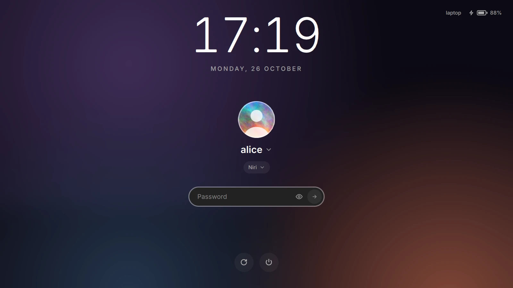
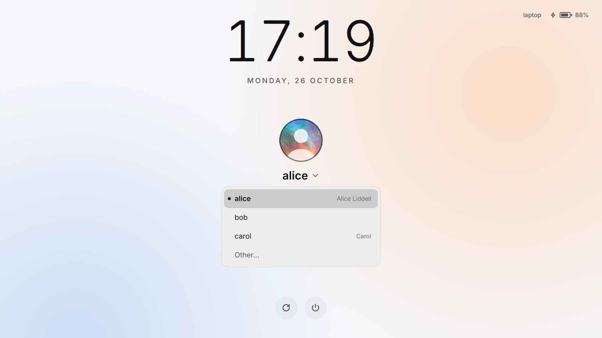
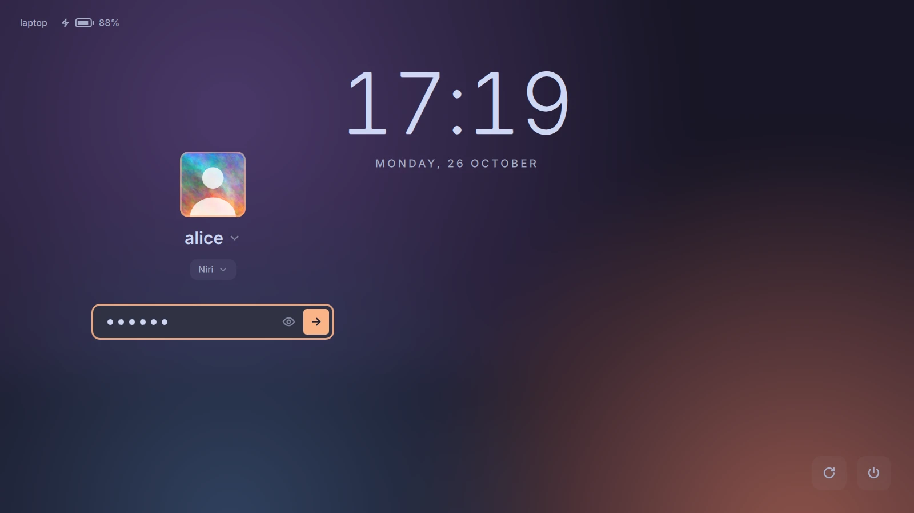
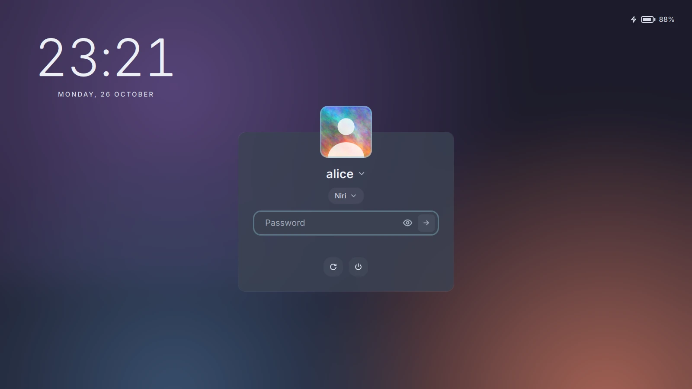
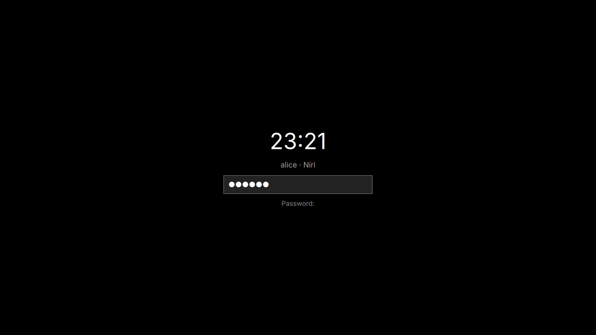

# Gallery

The built-in themes and the [examples](../examples), each with what puts
it on the screen. An example's files go to `/etc/yokoso/themes/` (on
NixOS, `services.yokoso.themes.<name>`, a look as `look = ./card.qml;`).

## dark

The default, over a picture of your own (`"background":
"/etc/yokoso/wallpaper.jpg"`).

## light

`"theme": "light"`, the user list open.

## high-contrast

`"theme": "high-contrast"`: white on black, a yellow accent and solid
outlines; Tab's ring on the session.

## Catppuccin Mocha, laid out

[`catppuccin-mocha.json`](../examples/catppuccin-mocha.json), with the form
on the left, the clock at the top and the power buttons in a corner:
`"layout": {"form": "left", "clock": "top", "power": "corner", "status":
"top-left"}` and `"radius": 12`.

## Card

[`card.json`](../examples/card.json) and its look
[`card.qml`](../examples/card.qml), made of yokoso's parts: Nord, the clock
in a corner, and the form on a card.

## Sidebar

[`sidebar.json`](../examples/sidebar.json) and
[`sidebar.qml`](../examples/sidebar.qml), made of the parts too: a panel
down the left side, on Catppuccin Mocha.

## Minimal

[`minimal.json`](../examples/minimal.json) and
[`minimal.qml`](../examples/minimal.qml): a look from scratch, as small as
a working one gets, without the parts.

