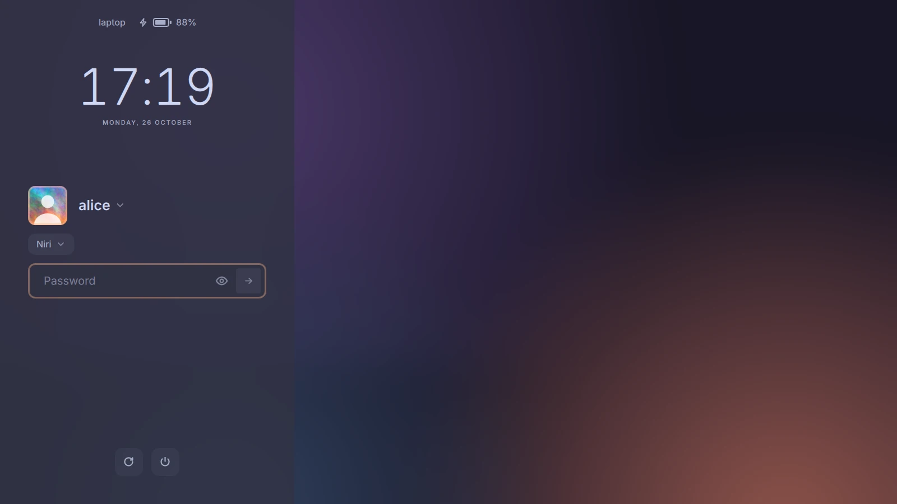

# Your own look

A theme's `look` is a QML file (relative to the theme, like `background`)
that draws the login screen in place of the built-in one,
[`shell/Look.qml`](../shell/Look.qml). One that can't be loaded gives way to
the built-in one, with a warning in the journal; for one that loads but
doesn't work, Ctrl+Alt+Shift+D brings up the built-in look in the built-in
theme until yokoso starts again. Try a look with `yokoso preview`
(`YOKOSO_CONFIG=<file>`) first.

[`examples/minimal.qml`](../examples/minimal.qml), with its
[theme](../examples/minimal.json), is about the smallest one that works. On
NixOS, `look = ./mine.qml;` in a theme copies the file to the store; a look
in several files is `look = "${./mine}/Look.qml";`.

## What it can use

Its root item has `required property var greeter`, yokoso's core, which
does the login, the power buttons and the memory, and watches the pointer.
`greeter.api` is `1`: what this table and the parts below are.

| | |
|---|---|
| `config`, `colors`, `fontFamily`, `animate` | the config over the theme, its colors and font; whether things should move |
| `tr(text)` | yokoso's English words in the config's language |
| `screens`, `area`, `backgroundFor(name)` | every screen in the window as `{ name, rect }`; the rectangle of the one with the form; a screen's background as a URL, the user's own first |
| `u(n)`, `dpr` | `n` pixels at the UI scale; the screen's device pixel ratio |
| `now`, `locale` | the time, by the minute; the system's locale for dates |
| `users`, `user`, `pickUser(u)` | the accounts as `{ name, realName, icon, background }`; the one logging in; another one, whose login then starts over |
| `needsUser`, `enterUser(name)`, `canEnterUser()` | no user yet (ask for a name); a typed name; whether one can be typed now |
| `sessions`, `session`, `pickSession(s)`, `sessionName(s)` | the sessions as `{ id, name, exec, type }`; the one to start; another one; a name to show |
| `canPick(which)` | whether another `"user"` or `"session"` can be picked now |
| `auth.phase` | `"starting"`, `"prompt"`, `"verifying"`, `"failed"` or `"launching"` |
| `auth.prompt`, `auth.secret`, `auth.submit(text)` | PAM's question and whether the answer is secret; answering it |
| `auth.message`, `auth.messageIsError` | PAM's last message, or "Wrong password", and whether it's an error |
| `problem` | why no login can start (no session), else `""` |
| `capsLock`, `numLock`, `hostname`, `battery` | the locks; the machine's name; `{ level, plugged }`, or `null` without one |
| `power`, `powerLabels`, `press(action)` | the power actions of `config.power` that logind allows (`"firmware"`, `"entry:<id>"` among them), what each does, and a press: a second one within `armedFor` ms acts |
| `powerAgain` | for each action, that it wants a second press |
| `armed`, `armedFor`, `powerError` | the action waiting for its second press; how long it waits; why one failed |
| `idle`, `wake()` | whether the screen is asleep; call `wake()` on every key and click, and when it returns `true` the input only woke the screen |

## Parts

`import yokoso` brings in the parts the built-in look is made of. They take
the theme's colors, font, corners and the UI scale, and do what they do in
the built-in look; where they go, their size, `opacity` and `transform` are
the look's. [`examples/sidebar.qml`](../examples/sidebar.qml), with its
[theme](../examples/sidebar.json), puts them in a panel down the side:

[`examples/card.qml`](../examples/card.qml) puts them on a card; the
[gallery](gallery.md) has it, and the rest.

| Part | |
|---|---|
| `Form` | what the form's parts share: the list that's open, a name typed instead of the password, where Tab took the keys. Make one and give it to them (`PowerBar` too) as `form` |
| `Background` | the user's or the theme's background on every screen, one fading in over the other; fill the look with it |
| `Clock` | the time, and the date under it; `size` (120) |
| `Status` | the theme's `status`, in a row |
| `Avatar` | the user's picture or initial; `form`, `user`; its `width` is its size |
| `UserName` | the user's name; `form`, `user`, `size` (24) |
| `SessionPill` | the session, with more than one; `form` |
| `PasswordField` | the field, its eye and its button; `form`, `size` (50) |
| `FieldNote` | the line under the field: a message too long for it, Caps Lock, Num Lock; `form` |
| `PowerBar` | the power buttons and what they say; `form`, `size` (48) |
| `Picker` | the open list, under `under` (the `UserName` or the `SessionPill` it's for); fill the look with it |
| `IdleCover` | dark while the screen is asleep; fill the look with it, over the rest |
| `Icon` | a line icon: `path` (`Greeter.icons.reboot`, or any SVG path on a 24x24 grid), `color`, `size` |
| `Greeter` | the core as `Greeter.core`, and `u(n)`, `colors`, `font`, `animate`, `round(size)`, `icons` |
