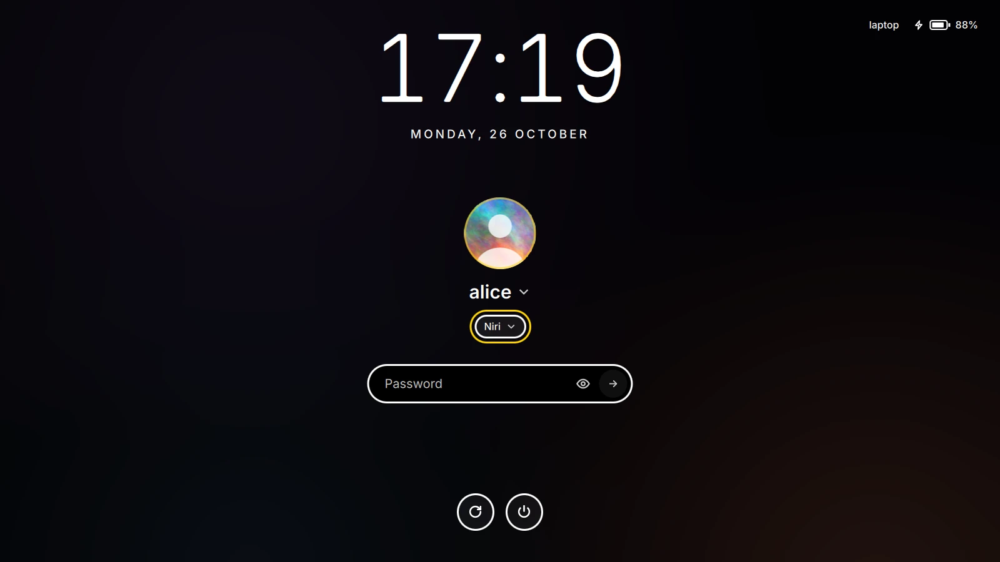

# Using yokoso

## Logging in

PAM's prompts and messages come as PAM sends them, a fingerprint reader's
included. A click on the name (or F2) picks another account, or "Other…" one
that isn't listed (LDAP's, a directory's); with `userList: false` a name is
typed every time. A click on the session (or F3) picks another session: the
desktop files', named in the system's language and without those whose
`TryExec` isn't installed, X11 ones through `startx`, and the
[config's own](config.md#sessions-of-your-own) first.

The next login starts with the last one's user and that user's session,
kept in `/var/lib/yokoso/state.json`; without that directory (it belongs to
the greeter's account) nothing is remembered and `user` and `session`
decide. A wrong password shakes the field; greetd can't change an expired
one, so yokoso says where to.

A user's picture is `/etc/yokoso/avatars/<name>`, in any format Qt reads,
else AccountsService's (`/var/lib/AccountsService/icons/<name>`), else their
initial. `/etc/yokoso/backgrounds/<name>` is a background of their own, on
every screen while they're picked, over the theme's.

## Keys

| | |
|---|---|
| F2, a click on the name or the picture | the user list; without one, the name to type again |
| F3, a click on the session | the session list |
| F4, a click on another screen | the form to that screen (the next one, for F4) until yokoso starts again |
| Tab, Shift+Tab | the name, the session, the field, its eye and the power buttons in turn; Enter or Space presses the one ringed, any other key goes back to the field |
| Up, Down, Enter, Escape | in a list |
| Enter | sends what's typed |
| Escape, Ctrl+U | clears the field; Escape also goes back from typing a name |
| Ctrl+Alt+Shift+D | safe mode: the built-in look in the built-in theme |
| Ctrl+Alt+F2 … F12 | a text console; back with greetd's (Ctrl+Alt+F1 by default) |
| any key, a click or a move | wakes a dark screen, and does nothing else |

A power button acts on a second press within three seconds. Which ones
there are, a reboot to the firmware's setup or into Windows among them,
is up to the [config](config.md#power-buttons).

## Seeing it

The UI scale comes from the screen's physical size (its EDID) before the
first frame; `scale` in the config sets it, larger for everything at once.
The `high-contrast` theme is white on black with a yellow accent and solid
outlines; the eye in the field shows the password as it's typed
(`reveal: false` takes it away). Things move unless everything is drawn in
software, or the theme says `"animations": false`.

## Several screens

The form goes on `output`, else on a laptop's own panel, or on an external
screen while the lid is closed, else on the first screen; the others show
the background. A closed laptop panel never gets the form while there's
another screen. With `"output": "cursor"` the form follows the pointer from
screen to screen. A click on another screen, or F4, takes it there: for a
screen that stays dark although it's connected.

Only the GPU that drives the screens is used, so a PRIME laptop's NVIDIA GPU
stays asleep.

## Idle

After `idle` seconds without input (60) the screen goes dark and the
backlight low, until any input wakes it.

## Keyboard and cursor

The keyboard layout is the system's: on NixOS, `services.xserver.xkb`;
elsewhere localed's (`localectl set-x11-keymap us,de "" ""
grp:alt_shift_toggle`), unless greetd's command sets `XKB_DEFAULT_LAYOUT`
and the rest.

A password typed in Cyrillic or Greek (a layout switched by mistake) gets
a word under the field, gone with the next Latin letter.

The cursor is `XCURSOR_THEME`'s, else the system's default theme, at
`XCURSOR_SIZE` (24) times the UI scale. On NixOS,
`services.yokoso.cursor` sets them; elsewhere greetd's command does
(`command = "env XCURSOR_THEME=Adwaita yokoso"`).

## Locking the screen

`yokoso lock`, in a Wayland session whose compositor locks screens
(ext-session-lock: sway, niri, Hyprland, labwc, river), locks them with the
greeter's look, theme and config, until the user's password. On NixOS that
takes `services.yokoso.lock.enable = true;` (for its PAM service,
`yokoso-lock`); elsewhere `make install` puts `/etc/pam.d/yokoso-lock`
there. Bind it to a key, or to the idle daemon's lock (`swayidle -w
before-sleep 'yokoso lock'`).

The form is on the screen the keys go to; the session's own idle daemon,
not yokoso, turns the screens off. Should yokoso stop, the compositor keeps
them locked.
