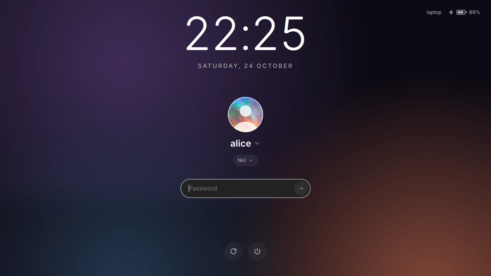
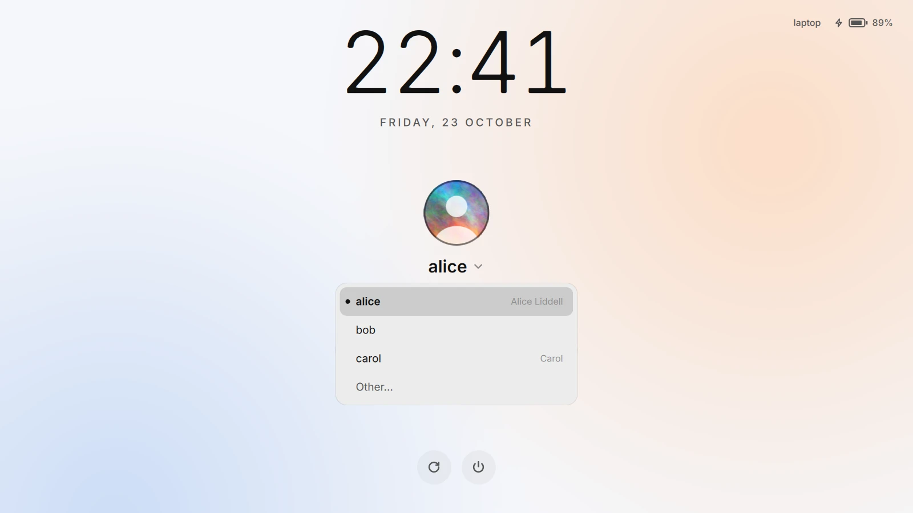
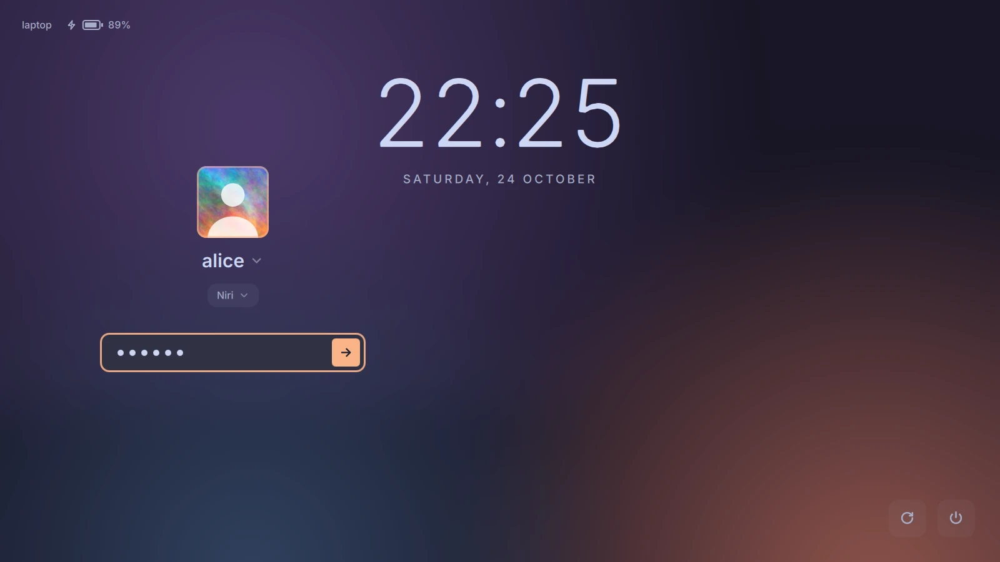
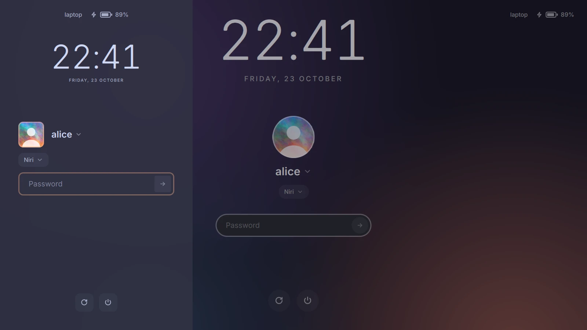

# yokoso

[](https://github.com/kontonkara/yokoso/actions/workflows/check.yml)

*ようこそ, "welcome".* A [greetd](https://sr.ht/~kennylevinsen/greetd/)
greeter on [Quickshell](https://quickshell.org). It runs in
[cage](https://github.com/cage-kiosk/cage), so it works whatever desktop it
logs into, and it's light enough for an integrated GPU.

<p>
  
  
</p>

## What it does

**Looks.** Built-in `dark` and `light` themes; any other is a small JSON
file of colors, a font, a background (per screen if you like), corners and
where the parts go. A theme can also bring a QML look of its own, made of
yokoso's parts or from scratch. A large clock in the system's locale,
the user's picture, a Caps Lock warning, a word when Num Lock is on, the
machine's name and battery, and the power buttons logind allows (a second
click confirms). Things move, unless everything is drawn in software.

**Logging in.** PAM's prompts and messages as PAM sends them, a
fingerprint reader's included. A click on the name (or F2) picks another
account, or "Other…" one that isn't listed (LDAP's, a directory's); a click
on the session (or F3) another session, X11 ones too (through `startx`),
named in the system's language, without those whose program isn't
installed (`TryExec`).
The next login starts with the last one's user and session. The keyboard
layout is the system's.

**On any machine.** The UI scale comes from the screen's physical size
(EDID) before the first frame. Only the GPU that drives the screens is
used: a PRIME laptop's NVIDIA GPU stays asleep. The form goes on the
laptop's panel, or an external screen while the lid is closed; every screen
gets the background. After a minute without input the screen goes dark and
the backlight low. It starts with greetd, not after the rest of the boot,
and early in the boot it waits for the GPU's driver instead of starting on
the firmware's framebuffer.

**When something goes wrong.** If yokoso can't start, greetd's text
greeter comes up in its place. A broken config or theme is left out with a
warning, and Ctrl+Alt+Shift+D brings back the built-in look from one that
keeps anyone from logging in. A session that ends right after it starts
doesn't just bring the login screen back: it says so. greetd can't change
an expired password, so for one yokoso says where to change it.

## Try it

```sh
nix run github:kontonkara/yokoso#preview
```

This opens the greeter in a window. It logs in against greetd's `fakegreet`:
the password is `password`, then `9`. Set `YOKOSO_CONFIG=<file>` to try a
config.

## NixOS

```nix
{
  inputs.yokoso.url = "github:kontonkara/yokoso";

  # in a module:
  imports = [ inputs.yokoso.nixosModules.default ];
  services.yokoso = {
    enable = true;
    settings.theme = "light";
  };
}
```

| Option | |
|---|---|
| `services.yokoso.enable` | greetd, with yokoso as its greeter |
| `settings` | `/etc/yokoso/config.json` (see [Config](#config)) |
| `themes.<name>` | `/etc/yokoso/themes/<name>.json`, for `settings.theme = "<name>"`; a `look = ./mine.qml;` in one is copied to the store |
| `avatars.<user>` | the user's picture (`./alice.png`) |
| `cursor.package`, `cursor.name`, `cursor.size` | the cursor theme (`pkgs.bibata-cursors`, `"Bibata-Modern-Classic"`), and its size at scale 1 (24) |
| `package` | yokoso itself |

The module also passes on the keyboard layout from
`services.xserver.xkb`, turns on `startx` for X11 sessions when
`services.xserver.enable` is set, and makes `/var/lib/yokoso` (the last
login) and `/var/cache/yokoso` (Mesa's and Qt's shader caches).

## Other systems

yokoso needs greetd (with agreety), Quickshell 0.3.1 or newer, cage, jq,
awk and systemd (`busctl`, `systemd-cat`); `yokoso preview` needs greetd's
`fakegreet` too, which not every distribution ships (Arch doesn't). On Arch,
[`dist/arch/PKGBUILD`](dist/arch/PKGBUILD) builds `yokoso-git`; elsewhere:

```sh
make install PREFIX=/usr
systemd-tmpfiles --create
```

Then greetd runs it, in `/etc/greetd/config.toml`:

```toml
[default_session]
command = "yokoso"
user = "greeter"
```

and `systemctl enable greetd` (with the display manager before it
disabled). `/var/lib/yokoso` and `/var/cache/yokoso` belong to the account
`greeter`; for another one, copy `/usr/lib/tmpfiles.d/yokoso.conf` to
`/etc/tmpfiles.d/` with its name. The keyboard layout is the system's
(`localectl set-x11-keymap us,de "" "" grp:alt_shift_toggle`), unless the
command sets `XKB_DEFAULT_LAYOUT` and the rest; a cursor theme is
`XCURSOR_THEME` and `XCURSOR_SIZE` there (`command = "env
XCURSOR_THEME=Adwaita yokoso"`). A user's picture is
`/etc/yokoso/avatars/<user>`, else AccountsService's.

## Keys

| | |
|---|---|
| F2, a click on the name or the picture | the user list; without one (`userList: false`), the name to type again |
| F3, a click on the session | the session list |
| F4, a click on another screen | the form to that screen (the next one, for F4), over `output` until yokoso starts again |
| Up, Down, Enter, Escape | in a list |
| Enter | sends what's typed |
| Escape | clears the field, and goes back from typing a name |
| Ctrl+Alt+Shift+D | safe mode: the built-in look in the built-in theme |
| Ctrl+Alt+F2 … F12 | a text console (cage switches VTs); back with greetd's (Ctrl+Alt+F1 by default) |
| any key, a click or a move | wakes a dark screen, and does nothing else |

## Config

`/etc/yokoso/config.json`. Every key is optional:

| Key | Default | |
|---|---|---|
| `user` | the first account | account to start with, listed or not (LDAP) |
| `userList` | `true` | list the accounts to pick from; `false` asks for a name every time (not the last login's) and shows no pictures |
| `session` | the first one | session to start with, by desktop file name (`niri`, `i3`); Wayland's come first |
| `remember` | `true` | start with the last login's user and that user's last session instead |
| `theme` | `dark` | `dark`, `light`, a theme's name or a theme file's path; see below |
| `output` | see below | screen with the form (`DP-1`), or `cursor` for the one the pointer is on |
| `scale` | `0` | UI scale; `0` takes it from the screen's size |
| `idle` | `60` | seconds without input before the screen goes dark and the backlight low; `0` for never |
| `language` | the locale's | the language of yokoso's own few words: `"en"` or `"ru"` (from `shell/i18n`); PAM's follow greetd's locale |
| `x11Wrapper` | `startx /usr/bin/env` | what starts an X server for an X11 session, with its command after it |

A config that isn't a JSON object is left out, and keys yokoso doesn't know
(a misspelt `thme`) are named, both in the journal (`journalctl -b -t
yokoso`).

The last login is kept in `/var/lib/yokoso/state.json`, so the greeter's
account has to own `/var/lib/yokoso` (the NixOS module makes it). Without
it nothing is remembered, and `user` and `session` decide.

A user's picture is `avatars/<name>` next to the config
(`/etc/yokoso/avatars/alice`, in any format Qt reads), else AccountsService's
(`/var/lib/AccountsService/icons/alice`); without one, it's their initial. On
NixOS, `services.yokoso.avatars.alice = ./alice.png;` puts it there.

The cursor is `XCURSOR_THEME`'s, else the system's default theme, at
`XCURSOR_SIZE` (24 by default) times the UI scale. On NixOS,
`services.yokoso.cursor = { package = pkgs.bibata-cursors; name =
"Bibata-Modern-Classic"; };` sets them.

With several screens the form goes on `output`, else on a laptop's own panel,
or on an external screen while the lid is closed, else on the first screen;
the others show just their background. A closed laptop panel never gets the
form while there's another screen, even as `output`. With `cursor`, the form
starts there too and then moves to whichever screen the pointer moves onto.
A click on another screen, or F4, takes the form there until yokoso starts
again: for a screen that stays dark although it's connected.

## Themes

The built-in ones are `dark` (the default) and `light`. Any other theme is a
JSON file: `"theme": "mine"` reads `themes/mine.json` next to the config
(`/etc/yokoso/themes/mine.json`), and a path reads that file.

```json
{
  "extends": "dark",
  "colors": {
    "background": "#1e1e2e",
    "text": "#cdd6f4",
    "subtext": "#a6adc8",
    "dim": "#7f849c",
    "field": "#313244",
    "accent": "#fab387",
    "error": "#f38ba8"
  },
  "font": "Inter",
  "background": "wallpaper.jpg",
  "backgroundDim": 0.4
}
```

Every key is optional. A theme goes on top of the one it `extends` (`dark`
when it doesn't say; by name, a theme in the same folder first), and the
config's own keys go on top of the theme, so `"colors": {"accent":
"#fab387"}` in the config changes just that (`layout` merges the same way).

| Key | |
|---|---|
| `colors.background` | behind everything, where there's no image |
| `colors.text` | the clock, the username, the lists' entries, what's typed and the icon of a power button under the pointer |
| `colors.subtext` | the date, the session, hints, the power buttons' icons, the status in the corner and Num Lock |
| `colors.dim` | the field's placeholder, its arrow until something is typed and the arrows by the names |
| `colors.field` | the password field and the user and session lists |
| `colors.accent` | the avatar, what's under the pointer, an armed power button, the picked entry in a list, the field's outline and its button once something is typed, and the spinner while a password is checked |
| `colors.error` | errors (and the field's outline with one), the Caps Lock warning and a low battery |
| `font` | a font family; `""` for the default one |
| `background` | an image for every screen, or one per output with `"*"` for the rest (`{"DP-1": "a.jpg", "*": "b.jpg"}`), cropped to fill each screen; paths are relative to the theme file |
| `backgroundDim` | how much `colors.background` covers the image, `0` to `1` |
| `animations` | the parts coming in one after another at the start and going as the session starts, the form sliding to another screen, buttons that answer the pointer, a ring running out around an armed power button, a shake at a wrong password, the spinner, password dots that pop up, the clock's figures rolling over, lists that drop in with a highlight that slides; `"auto"` (the default) for them unless everything is drawn in software (a VM without 3D), `true`, or `false` for none |
| `status` | what a top corner shows: `"hostname"`, `"battery"` (a laptop's), both by default; `[]` for nothing |
| `layout.form` | the form in the `"center"` of the screen, on the `"left"` or on the `"right"` |
| `layout.clock` | the clock `"above"` the form, at the `"top"` of the screen, or `"none"` |
| `layout.power` | the power buttons at the `"bottom"`, in its right `"corner"`, or `"none"` |
| `layout.status` | the status in the `"top-right"` or `"top-left"` corner |
| `clockFormat` | the time as a [Qt format](https://doc.qt.io/qt-6/qml-qtqml-qt.html#formatDateTime-method) (`"HH:mm"`); `""` for the locale's short one |
| `dateFormat` | the date likewise (`"dddd d MMMM"`); `""` for the locale's long one without the year |
| `radius` | the corners of the field, the buttons, the lists and the avatar, in pixels; `null` for round |
| `fieldWidth` | the form's width, in pixels |
| `look` | a QML file that draws the login screen instead; see below |

A theme that can't be read is skipped (with a warning in the journal), so a
broken one never stands between anyone and the login.
[`examples/catppuccin-mocha.json`](examples/catppuccin-mocha.json) is one to
start from. On NixOS, `services.yokoso.themes.<name>` writes them.



*`catppuccin-mocha.json`, with `"layout": {"form": "left", "clock": "top",
"power": "corner", "status": "top-left"}` and `"radius": 12`.*

## Your own look

A theme's `look` is a QML file (a path relative to the theme, like
`background`) that draws the login screen in place of the built-in one,
[`shell/Look.qml`](shell/Look.qml). If it can't be loaded, the built-in one
comes up instead, with a warning in the journal. For one that loads but
doesn't work (or a theme whose colors hide the field), **Ctrl+Alt+Shift+D**
brings up the built-in look in the built-in dark theme until the greeter
starts again: safe mode. Still, try a look with `yokoso preview` first
(`YOKOSO_CONFIG=<file>`). [`examples/minimal.qml`](examples/minimal.qml),
with [`examples/minimal.json`](examples/minimal.json), is about the smallest
one that works. On NixOS, `look = ./mine.qml;` in a theme copies the file to
the store; a look in several files is `look = "${./mine}/Look.qml";`.

Its root item has `required property var greeter`: yokoso's core, which
does the login, the power buttons and the memory, and watches the pointer.

| | |
|---|---|
| `config`, `colors`, `fontFamily`, `animate` | the config over the theme, its colors, its font; whether things should move (`animations` worked out) |
| `tr(text)` | yokoso's English words in the config's language, when `shell/i18n` has them |
| `screens`, `area`, `backgroundFor(name)` | every screen in the window as `{ name, rect }`; the rectangle of the one with the form; a screen's background as a URL |
| `u(n)`, `dpr` | `n` pixels at the UI scale; the screen's device pixel ratio |
| `now`, `locale` | the time, by the minute; the system's locale for dates |
| `users`, `user`, `pickUser(u)` | the accounts as `{ name, realName, icon }` (none with `userList: false`); the one logging in; another one, whose login then starts over |
| `needsUser`, `enterUser(name)`, `canEnterUser()` | no user yet (ask for a name); a typed name, listed or not, whose login then starts over; whether one can be typed now |
| `sessions`, `session`, `pickSession(s)`, `sessionName(s)` | the sessions as `{ id, name, exec, type }`; the one to start; another one; a name to show |
| `canPick(which)` | whether another `"user"` or `"session"` can be picked now |
| `auth.phase` | `"starting"`, `"prompt"`, `"verifying"`, `"failed"` or `"launching"` |
| `auth.prompt`, `auth.secret`, `auth.submit(text)` | PAM's question and whether the answer is secret; answering it |
| `auth.message`, `auth.messageIsError` | PAM's last message, or "Wrong password", and whether it's an error |
| `problem` | why no login can start (no session), else `""` |
| `capsLock`, `numLock`, `hostname`, `battery` | Caps Lock; Num Lock; the machine's name; `{ level, plugged }`, or `null` without one |
| `power`, `powerLabels`, `press(action)` | the power actions logind allows, their names, and a press: a second one within `armedFor` ms acts |
| `armed`, `armedFor`, `powerError` | the action waiting for its second press; how long it waits; why one failed |
| `idle`, `wake()` | whether the screen is asleep (the core dims the backlight, the look darkens the rest); call `wake()` on every key and click, and when it returns `true` the input only woke the screen |

`greeter.api` is `1`: what this table and the parts below are.

### Parts

`import yokoso` brings in the parts the built-in look is made of, to make a
look of one's own from: [`examples/sidebar.qml`](examples/sidebar.qml),
with [`examples/sidebar.json`](examples/sidebar.json), puts them in a panel
down the side. They take the theme's colors, font, corners and the UI
scale, and do what they do in the built-in look; where they go, how large
they are, and their `opacity` and `transform` are the look's.



| Part | |
|---|---|
| `Form` | what the form's parts share: the list that's open, a name typed instead of the password, what keys do. Make one and give it to them as `form` |
| `Background` | the theme's background on every screen; fill the look with it |
| `Clock` | the time, and the date under it; `size` (120) |
| `Status` | the theme's `status`, in a row |
| `Avatar` | the user's picture or initial; a click picks another. `form`, `user`; its `width` is its size |
| `UserName` | the user's name; a click picks another. `form`, `user`, `size` (24) |
| `SessionPill` | the session, with more than one; a click picks another. `form` |
| `PasswordField` | the field and its button; `form`, `size` (50) |
| `FieldNote` | the line under the field: a message too long for it, Caps Lock, Num Lock; `form` |
| `PowerBar` | the power buttons and what they say; `size` (48) |
| `Picker` | the open list, under `under` (the `UserName` or the `SessionPill` it's for); fill the look with it |
| `IdleCover` | dark while the screen is asleep; fill the look with it, over the rest |
| `Icon` | a line icon: `path` (`Greeter.icons.reboot`, or any SVG path on a 24x24 grid), `color`, `size` |
| `Greeter` | the core as `Greeter.core` (the look's `greeter`), and `u(n)`, `colors`, `font`, `animate`, `round(size)`, `icons` |

## When something goes wrong

- `journalctl -b -t yokoso` has what the launcher, cage and Quickshell
  said: a theme or a config left out, unknown keys, the wait for a GPU's
  driver, a session left out for its TryExec, why yokoso fell back to
  agreety.
- If yokoso can't start, greetd's text greeter (agreety) logs in to the
  same session instead.
- A theme or a look that keeps anyone from logging in: Ctrl+Alt+Shift+D.
  Try a theme or a look with `yokoso preview` (`YOKOSO_CONFIG=<file>`)
  before it's the login screen.
- A session that ends right after it starts says so under the field; its
  own messages are in `journalctl -b`.
- Up to 10 s of black at boot: the GPU's driver isn't in the initrd, and
  yokoso waits for it. Putting it there (`hardware.amdgpu.initrd.enable`,
  `boot.initrd.kernelModules`, or the distribution's way) saves the wait.

## Developing

`nix run .#shots -- <dir>` renders the working tree's greeter headless, with
fake users and sessions, in the scenarios of
[`tests/shots.sh`](tests/shots.sh) (the lists, a wrong password, two
screens, idle, Russian, a layout, looks of one's own, ...) into `<dir>`;
`--against <an earlier dir>` counts the pixels that changed. `nix run
.#docs-shots` redraws the README's pictures in `docs/`.

`nix flake check` runs shellcheck and the VM tests in
[`tests/vm`](tests/vm): the greeter under the real greetd, PAM and cage,
logging in through the lists, idle, the power buttons, PAM's messages, an
expired password, a fingerprint, a session that ends at once, a GPU driver
that loads after the greeter starts, a layout from localed and an install
with `make` instead of the module. GitHub runs it on every push and pull
request.
